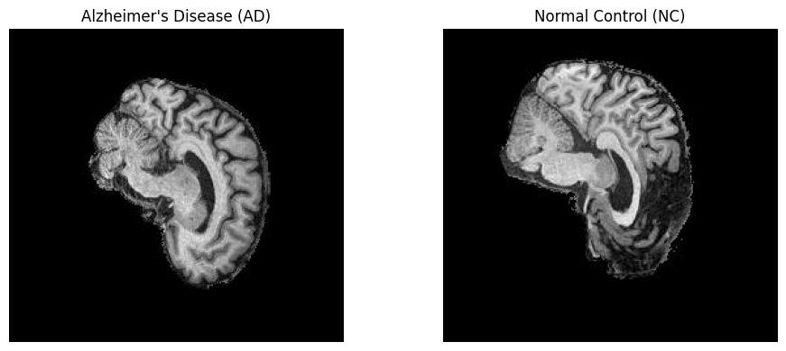
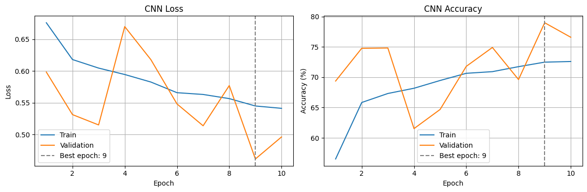
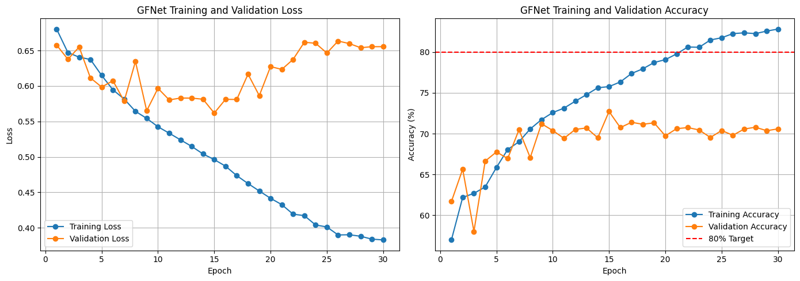
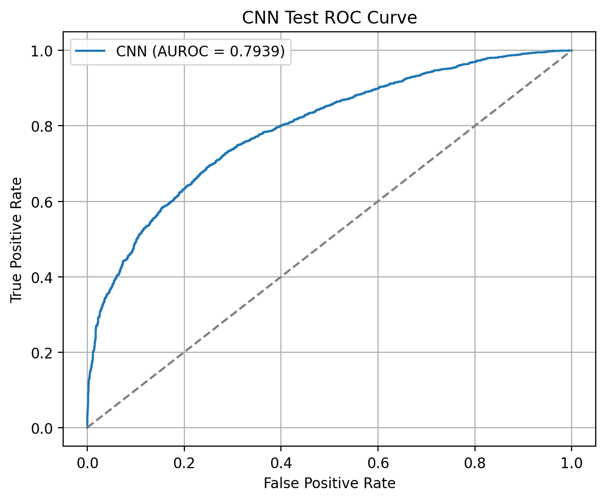
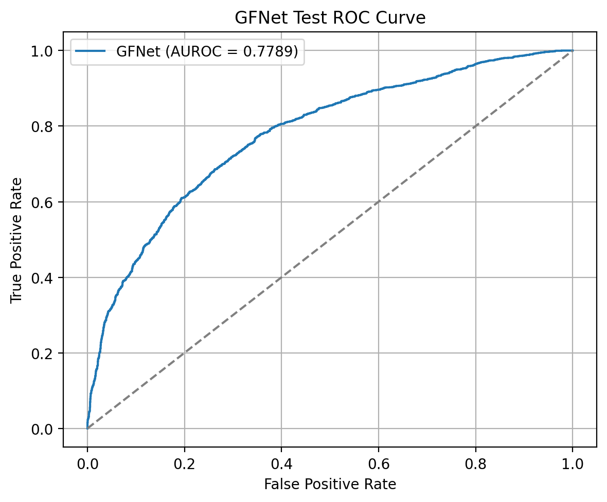
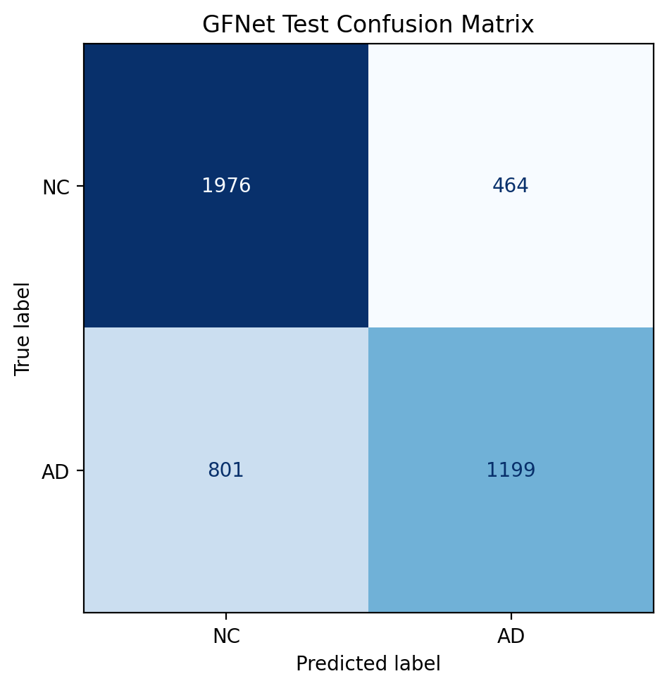
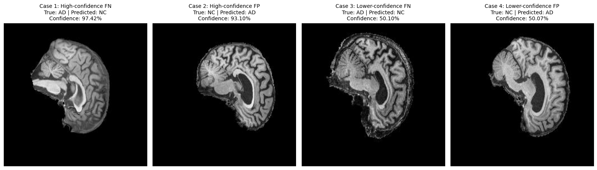

# ADNI MRI Classification Using a GFNet-Inspired Model and a CNN Baseline

## 1. Project Overview

This project investigates the classification of two-dimensional brain MRI slices into Alzheimer’s disease (AD) and normal control (NC) categories using the ADNI dataset. A GFNet-inspired model is implemented and compared with a simple convolutional neural network (CNN) baseline. Both models use the same patient-independent training, validation, and test splits, ensuring that all images belonging to a patient remain within a single partition. Predictions and performance metrics are evaluated at the slice level.

The GFNet-inspired model divides each image into patches and uses learnable frequency-domain filters to mix information across the spatial feature grid. Each block contains separate residual connections around the global filtering operation and the multilayer perceptron. The CNN baseline uses three convolutional stages followed by global average pooling and a classification layer. This comparison investigates whether global frequency-domain processing provides useful improvements over a compact convolutional model.

The evaluation addresses both classification performance and the confidence and ambiguity dilemma in automated triage. Accuracy, per-class precision and recall, macro-F1, and AUROC are used to compare predictive performance. Further analysis examines representative misclassifications, prediction confidence, and computational cost to assess the trade-off between model complexity and practical utility. The intended outcome is an evidence-based recommendation on the prototype’s limitations and the conditions under which predictions should be referred for human review.

## 2. Feasibility Review — GFNet for Alzheimer's Disease Classification
This section records the initial feasibility review prepared for the midpoint check-off. It describes the proposed approach and preliminary evidence at that stage; the final implementation and experimental results are documented in the subsequent sections. CN is referred to as NC elsewhere in this report, following the dataset folder labels.

**COMP3710 Open-Ended Project | Domain: Medical Image Classification | Difficulty: Hard**

### 2.1 User Need, Scope & Acceptance Criteria

This project aims to develop a deep learning prototype to assist medical reviewers in distinguishing Alzheimer's Disease (AD) from Cognitively Normal (CN) cases using 2D T1-weighted brain MRI slices from the ADNI dataset. The system will compare a conventional CNN baseline with a Global Filter Network (GFNet), while investigating prediction confidence and identifying uncertain cases requiring expert review.

**Acceptance criteria:**

- Achieve at least 80% test accuracy for AD versus CN classification, following the course specification [4].
- Compare GFNet against a CNN baseline using accuracy, per-class precision, recall, macro-F1, and AUROC.
- Prevent patient-level data leakage across training, validation, and test sets.
- Evaluate prediction confidence and investigate 3–5 representative failure cases.
- Establish an empirical confidence threshold for referring uncertain predictions to human reviewers, and report inference latency and GPU memory usage.

### 2.2 Model Choice & Course Concepts

The project uses the ADNI dataset, comprising 2D MRI slices labelled AD or CN. A simple CNN will serve as the baseline, while GFNet is the selected advanced architecture (Hard Difficulty).

GFNet replaces conventional self-attention with global frequency-domain filtering using the 2D Fast Fourier Transform (FFT), learnable frequency-domain filters, and inverse FFT. This approach enables global spatial information mixing. Relevant course concepts include convolutional neural networks, Fourier transforms, backpropagation, classification metrics, and model generalisation.

Both models will be trained and evaluated using the same patient-independent data partitions.

### 2.3 Preliminary Feasibility Evidence

Initial data inspection identified 10,400 AD and 11,121 CN training slices, together with 4,460 AD and 4,540 CN test slices. Images are grayscale with a resolution of 256 × 240 pixels.

Metadata analysis identified 680 unique subjects, with 216 subjects appearing in both the supplied training and test partitions. All examined image identifiers were successfully mapped to metadata, and no conflicting AD/CN subject labels were detected.

This demonstrates a significant patient-level leakage risk in the supplied split. A new stratified, subject-level 70/15/15 training, validation, and test partition is proposed. Model training and computational feasibility testing remain pending.

### 2.4 Risks, Budget & Fallback

**Key risks:** Patient-level leakage, limited GPU availability, GFNet training cost, overfitting, and unreliable confidence estimates.

**Mitigation:** Use patient-independent partitions, reduced image resolution where appropriate, smaller training batches, early stopping, and reproducible experiments.

**Computing budget:** Google Colab GPU resources, with peak VRAM, epoch duration, and inference latency to be measured during initial experiments.

**Next experiment:** Construct the patient-independent data splits, train a small CNN baseline, and benchmark GFNet training feasibility on a limited subset.

**Fallback:** If the full GFNet architecture exceeds available resources, use a reduced-width GFNet retaining its core Fourier filtering mechanism, and report the computational trade-offs.

## 3. Dataset and Preprocessing

### 3.1 Dataset Overview and Data Audit

This project uses the course-provided preprocessed version of the ADNI dataset [3, 4], containing two-dimensional grayscale MRI slices labelled as Alzheimer’s disease (AD) or normal control (NC). The initial inventory contained 30,521 image records from 680 unique patients. Patient identifiers were extracted from the metadata and associated with individual image records using their image IDs. All image records were successfully mapped to patients, and no conflicting class labels were found within patients.

An audit of the original training and test folders identified 216 patients appearing in both partitions. Therefore, the original folder assignments were not used as the final experimental splits. One previously identified duplicate record, `976382_96 (1).jpeg`, was removed, leaving 30,520 images for subsequent experiments.



*Figure 1. Example grayscale MRI slices from the provided ADNI dataset: AD (left) and NC (right), shown before resizing and training augmentation. Labels follow the dataset annotations.*

### 3.2 Patient-Level Data Splitting

The dataset was repartitioned using class-stratified sampling at the patient level. First, 70% of patients were assigned to training. The remaining 30% were divided equally into validation and test sets. Both splitting operations used a random seed of 42.

All images belonging to the same patient were assigned to one partition. This prevents slices or repeated scans from a patient appearing across training, validation, and test sets. Assertions verified that patient identifiers and image paths did not overlap between partitions, and that all retained patients and image records were included.

| Split | Patients | NC patients | AD patients | NC images | AD images | Total images |
|---|---:|---:|---:|---:|---:|---:|
| Training | 476 | 321 | 155 | 11,000 | 10,620 | 21,620 |
| Validation | 102 | 69 | 33 | 2,220 | 2,240 | 4,460 |
| Test | 102 | 69 | 33 | 2,440 | 2,000 | 4,440 |
| Total | 680 | 459 | 221 | 15,660 | 14,860 | 30,520 |

The 70/15/15 proportions refer to patients rather than images. Image-level proportions differ because patients contribute different numbers of images. Stratification preserves the approximate patient-level class distribution; it does not enforce an equal number of AD and NC images.

Both the CNN baseline and the GFNet-inspired model use these same splits. Validation loss is used to select the best checkpoint within each training run. The selected checkpoint is subsequently evaluated on the test set.

### 3.3 Image Preprocessing

Images are loaded as single-channel grayscale inputs and resized to 256 × 256 pixels. Pixel intensities are converted to floating-point tensors and normalized using a mean of 0.5 and a standard deviation of 0.5:

$$
x_{\mathrm{normalized}} = \frac{x - 0.5}{0.5}
$$

Here, $x$ is the pixel intensity after conversion to the range $[0,1]$. This maps intensities to $[-1,1]$. The same deterministic preprocessing is applied to validation and test images.

For efficient data loading, the image archives are extracted from Google Drive to local Colab storage. Local paths preserve each image’s original relative folder location, independently of its new split assignment. File-existence checks confirm that all images referenced by the final splits are available.

### 3.4 Training Data Augmentation

Training augmentation differs between the two models. Both use the same deterministic resizing and normalization for validation and testing.

| Augmentation | CNN baseline | GFNet-inspired model |
|---|---|---|
| Random horizontal flip | Not used | Probability 0.5 |
| Random rotation | Up to ±10° | Up to ±10° |
| Random translation | Up to 5% in each direction | Not used |
| Random scaling | Scale factor 0.98–1.02 | Not used |
| Random erasing | Probability 0.4; area fraction 0.01–0.10; aspect ratio 0.5–2.0 | Not used |
| Elastic transformation | Probability 0.3; alpha = 10.0; sigma = 3.0 | Not used |

Augmentation is applied only to training images. Its individual effects have not been isolated through controlled ablation experiments. Because the augmentation pipelines differ, the comparison evaluates the two implemented systems rather than isolating the effect of architecture alone.

## 4. Model Architectures

### 4.1 CNN Baseline

A compact CNN is implemented as the baseline for comparison with the GFNet-inspired model. It receives a single-channel 256 × 256 MRI slice and produces two logits corresponding to NC and AD.

The feature extractor contains three convolutional stages. Each stage consists of a 3 × 3 convolution with stride 1 and padding 1, a ReLU activation, and a 2 × 2 max-pooling operation with stride 2. The channel dimensions increase from 1 to 32, 64, and 128.

| Component | Configuration | Output shape, excluding batch |
|---|---|---|
| Input | Grayscale MRI slice | 1 × 256 × 256 |
| Convolutional stage 1 | Conv 1 → 32, ReLU, max pooling | 32 × 128 × 128 |
| Convolutional stage 2 | Conv 32 → 64, ReLU, max pooling | 64 × 64 × 64 |
| Convolutional stage 3 | Conv 64 → 128, ReLU, max pooling | 128 × 32 × 32 |
| Global average pooling | Adaptive average pooling to 1 × 1 | 128 × 1 × 1 |
| Classifier | Flatten and linear projection | 2 |

Global average pooling summarises each feature channel over the spatial dimensions. A linear layer maps the resulting 128-dimensional representation to the two output logits. This avoids a large fully connected layer operating on flattened spatial feature maps.

The baseline contains **92,930 trainable parameters**. Its compact architecture provides a reference for assessing whether the additional complexity of the GFNet-inspired model improves classification performance.

### 4.2 GFNet-Inspired Architecture

The advanced model follows the global filtering concept introduced by Rao et al. [1], with implementation reference to the authors’ code repository [2]. The present implementation uses separate residual connections around the global filtering and MLP branches.

Each 256 × 256 input image is divided into non-overlapping 16 × 16 patches using a convolution with kernel size 16 and stride 16. Each patch is projected into a 128-dimensional feature vector, producing a 16 × 16 feature grid containing 256 patch representations.

A learnable positional embedding is added to this grid, followed by dropout. The features then pass through eight global filter blocks. A final layer normalization and spatial average pooling produce a 128-dimensional image representation, which is mapped to two output logits.

| Component | Configuration |
|---|---|
| Input | Single-channel 256 × 256 MRI slice |
| Patch embedding | Conv2d, kernel size 16, stride 16, 128 output channels |
| Feature grid | 16 × 16 spatial positions |
| Positional embedding | Learnable tensor of shape 1 × 16 × 16 × 128 |
| Global filter blocks | 8 |
| Embedding dimension | 128 |
| MLP hidden dimension | 512 |
| Activation | GELU |
| Dropout probability | 0.1 |
| Final normalization | LayerNorm |
| Pooling | Average over the spatial grid |
| Classifier | Linear projection from 128 features to 2 logits |

The model contains **1,418,882 trainable parameters**, approximately 15.3 times the parameter count of the CNN baseline.

### 4.3 Global Filter Layer

The global filter operates independently on each feature channel. First, a two-dimensional real FFT transforms the spatial feature map into the frequency domain. The resulting coefficients are multiplied element-wise by learnable complex-valued weights. An inverse FFT then converts the filtered features back into the spatial domain:

$$
G(X) =
\mathcal{F}^{-1}
\left(
W \odot \mathcal{F}(X)
\right),
$$

where $\mathcal{F}$ denotes the two-dimensional Fourier transform, $W$ contains the learnable complex-valued filter weights, and $\odot$ denotes element-wise multiplication.

In the implementation, `torch.fft.rfft2` and `torch.fft.irfft2` use orthonormal normalization. For a 16 × 16 spatial grid, the stored real-FFT representation has dimensions 16 × 9 per channel. The real and imaginary components of the filter weights are stored in a parameter tensor of shape 128 × 16 × 9 × 2.

This operation provides global spatial mixing within each channel. The subsequent MLP mixes information across feature channels at each spatial position.

### 4.4 Residual Block Design

Each block contains two residual connections. The first surrounds the global filter branch, while the second surrounds the MLP branch:

$$
Y = X + G(\mathrm{LN}_1(X))
$$

$$
Z = Y + \mathrm{MLP}(\mathrm{LN}_2(Y))
$$

Here, LN1 and LN2 are separate layer normalization operations. The MLP expands the feature dimension from 128 to 512, applies GELU and dropout, and projects the features back to 128 dimensions before a second dropout operation.

The residual connections provide identity paths alongside the learned transformations. Their individual contribution to performance has not been established through a controlled ablation experiment.

### 4.5 Classification Outputs

Both models return two unnormalized logits. Class 0 represents NC, and class 1 represents AD. Cross-entropy loss is applied directly to the logits during training.

For evaluation, the predicted class is obtained using `argmax`. Softmax is applied to obtain class probabilities, and the probability assigned to AD is used to calculate AUROC. These probabilities are model confidence scores and are not assumed to be calibrated estimates of diagnostic reliability.

## 5. Experimental Setup

### 5.1 Shared Experimental Conditions and Model-Specific Settings

Both models use the same patient-independent training, validation, and test partitions described in Section 3. They share the same input resolution, normalization, batch size, and deterministic validation and test preprocessing. Their training augmentation pipelines differ, as detailed in Section 3.4.

Experiments are conducted in Google Colab using an NVIDIA A100-SXM4 GPU with 40 GB of memory. Images are loaded from local Colab storage after extraction from Google Drive.

| Setting | CNN baseline | GFNet-inspired model |
|---|---|---|
| Input size | 1 × 256 × 256 | 1 × 256 × 256 |
| Batch size | 32 | 32 |
| Training epochs | 10 | 30 |
| Loss function | CrossEntropyLoss | CrossEntropyLoss |
| Optimizer | Adam | AdamW |
| Initial learning rate | 0.001 | 0.0003 |
| Weight decay | 0 | 0.0005 |
| Learning-rate scheduler | None | CosineAnnealingLR |
| Scheduler T_max | Not applicable | 30 epochs |
| Minimum learning rate | Not applicable | 0.000001 |
| DataLoader workers | 8 | 8 |
| Pinned memory | Enabled | Enabled |
| Checkpoint selection | Lowest validation loss | Lowest validation loss |

The CNN training pipeline includes random rotation, translation, scaling, erasing, and elastic deformation. The GFNet training pipeline uses random horizontal flipping and rotation. Neither model applies random augmentation during validation or testing.

Training data are shuffled at each epoch. Validation and test data are evaluated without shuffling.

The shared data partitions and evaluation procedures support a comparison of the two implemented systems. However, the models differ in architecture, training augmentation, optimizer, and learning-rate schedule. Therefore, performance differences cannot be attributed exclusively to model architecture.

### 5.2 Training Procedure

Both models are trained from scratch. For each training batch, the model produces two logits, and cross-entropy loss is calculated against the integer class labels. Gradients are computed through backpropagation, and the optimizer updates the model parameters.

Epoch loss is calculated as the sample-weighted average of batch losses:

$$
L_{\mathrm{epoch}} = \frac{\sum_{b=1}^{B} n_b L_b}{\sum_{b=1}^{B} n_b},
$$

where $L_b$ is the mean loss for batch $b$, and $n_b$ is the number of samples in that batch. This accounts for the potentially smaller final batch.

Accuracy is calculated as the number of correct predictions divided by the total number of evaluated images. Training and validation losses and accuracies are recorded after each epoch.

For GFNet, the learning rate is updated after each epoch using cosine annealing, with `T_max = 30` and `eta_min = 1e-6`. The CNN baseline uses a constant learning rate.

### 5.3 Validation and Checkpoint Selection

After each training epoch, the model is evaluated on the validation set using evaluation mode and disabled gradient computation. Whenever validation loss improves, the model weights are saved.

The best checkpoint is therefore defined by the lowest validation loss, rather than the highest training accuracy or the final training epoch. Before final evaluation, the saved checkpoint is reloaded and the model is placed in evaluation mode.

Although early stopping was considered in the initial feasibility review, the implemented training procedure uses fixed budgets of 10 epochs for the CNN and 30 epochs for GFNet. Each model retains the checkpoint with the lowest validation loss.

### 5.4 Reproducibility

A random seed of 42 is used for patient-level splitting and for NumPy and PyTorch random number generation. CUDA random seeds are also set. The CNN notebook additionally seeds Python's `random` module.

Seeds help reduce variation between runs, but the experiments do not enforce fully deterministic GPU execution. Consequently, exact numerical reproducibility across hardware or software environments is not guaranteed.

### 5.5 Evaluation Protocol

The selected checkpoints are evaluated on the same test set of 4,440 MRI slices from 102 patients. Metrics are calculated at the slice level.

The evaluation includes:

- Overall accuracy.
- Per-class precision, recall, and F1-score.
- Macro-averaged F1-score.
- Balanced accuracy.
- AUROC using the predicted probability of AD.
- Confusion matrices and ROC curves.

AD is treated as the positive class. Therefore, AD recall measures the proportion of AD-labelled slices correctly classified, while NC recall measures the proportion of NC-labelled slices correctly classified.

The final partitions are patient-independent. However, test results were inspected during exploratory development and informed some subsequent experimental choices. The reported test performance therefore has a limitation associated with repeated test-set feedback and should not be interpreted as a completely untouched confirmatory evaluation.

## 6. Results and Comparison

### 6.1 Training and Model Selection

The CNN completed 10 training epochs, while GFNet completed 30. Checkpoints were selected using the lowest validation loss and reloaded before test evaluation.

| Metric | CNN baseline | GFNet-inspired model |
|---|---:|---:|
| Completed epochs | 10 | 30 |
| Best epoch | 9 | 15 |
| Best validation loss | 0.4618 | 0.5618 |
| Validation accuracy at selected checkpoint | 78.99% | 72.71% |
| Final-epoch training accuracy | 72.59% | 82.80% |
| Final-epoch validation accuracy | 76.59% | 70.58% |

Both models continued to improve on the training set after their best validation checkpoints, without corresponding improvements in validation loss. For GFNet, training loss decreased from 0.4962 at epoch 15 to 0.3830 at epoch 30, while validation loss increased from 0.5618 to 0.6554. This pattern is consistent with overfitting and supports evaluating the selected checkpoint rather than the final-epoch weights.



*Figure 2. CNN training and validation curves over 10 epochs. The best checkpoint was selected at epoch 9.*



*Figure 3. GFNet training and validation curves over 30 epochs. The best checkpoint was selected at epoch 15.*

### 6.2 Test Performance

Both selected checkpoints were evaluated on the same 4,440 test slices from 102 patients.

| Metric | CNN baseline | GFNet-inspired model |
|---|---:|---:|
| Test loss | 0.5559 | 0.5801 |
| Accuracy | 72.36% | 71.51% |
| Balanced accuracy | 71.25% | 70.47% |
| Macro precision | 0.7265 | 0.7163 |
| Macro recall | 0.7125 | 0.7047 |
| Macro F1 | 0.7141 | 0.7061 |
| AUROC | 0.7939 | 0.7789 |

The CNN achieved slightly higher accuracy, balanced accuracy, macro-F1, and AUROC in this experiment. Its accuracy exceeded GFNet by approximately 0.86 percentage points, calculated from the underlying prediction counts. These results do not demonstrate an overall performance advantage for the GFNet-inspired model under the evaluated settings.

The GFNet test accuracy of 71.51% did not meet the initial 80% acceptance target. This result is reported without substituting validation accuracy or results from earlier model versions.



*Figure 4. CNN test ROC curve, with AD as the positive class. AUROC = 0.7939.*



*Figure 5. GFNet test ROC curve, with AD as the positive class. AUROC = 0.7789.*

### 6.3 Per-Class Performance

| Model | Class | Precision | Recall | F1-score | Support |
|---|---|---:|---:|---:|---:|
| CNN | NC | 0.7158 | 0.8246 | 0.7663 | 2,440 |
| CNN | AD | 0.7373 | 0.6005 | 0.6619 | 2,000 |
| GFNet | NC | 0.7116 | 0.8098 | 0.7575 | 2,440 |
| GFNet | AD | 0.7210 | 0.5995 | 0.6547 | 2,000 |

The CNN achieved higher precision, recall, and F1-score for both classes in this run. AD recall was similar between models: 60.05% for CNN and 59.95% for GFNet. The difference in NC recall was larger, at 82.46% for CNN and 80.98% for GFNet.

These class-specific results reveal limitations that are less apparent from overall accuracy alone.

### 6.4 Confusion Matrix Analysis

With AD treated as the positive class, the test predictions were:

| Outcome | CNN baseline | GFNet-inspired model |
|---|---:|---:|
| True negative: NC predicted as NC | 2,012 | 1,976 |
| False positive: NC predicted as AD | 428 | 464 |
| False negative: AD predicted as NC | 799 | 801 |
| True positive: AD predicted as AD | 1,201 | 1,199 |

Relative to the CNN, GFNet produced 36 more false positives and 2 more false negatives. The difference in total correct predictions was therefore mainly associated with NC classification.

These counts describe MRI slices, not independent patient diagnoses. Multiple slices from the same patient may contribute to the same error pattern.


*Figure 6. CNN test confusion matrix. Rows represent true labels and columns represent predicted labels.*



*Figure 7. GFNet test confusion matrix. Rows represent true labels and columns represent predicted labels.*

### 6.5 Interpretation

The larger GFNet-inspired model did not outperform the compact CNN baseline on the principal aggregate test metrics in this run. However, this comparison does not establish that CNNs are generally superior to global filter networks. The models used different augmentation and optimization settings, and the reported results are based on one training run per model.

The small performance differences have not been assessed using repeated runs or patient-level uncertainty estimates. Furthermore, AUROC measures discrimination across decision thresholds; it does not establish that predicted probabilities are calibrated.

The following analyses examine confidence, representative failure cases, and computational cost to assess whether either model offers a useful operational trade-off.

## 7. Prediction Confidence and Failure Analysis

### 7.1 Prediction Confidence Comparison

Prediction confidence is defined as the maximum softmax probability across the NC and AD classes. Confidence statistics are calculated separately for correct and incorrect predictions on the same test set of 4,440 slices.

| Model | Prediction outcome | Number of slices | Mean confidence | Median confidence |
|---|---|---:|---:|---:|
| CNN | Correct | 3,213 | 0.7710 | 0.7875 |
| CNN | Incorrect | 1,227 | 0.6827 | 0.6548 |
| GFNet | Correct | 3,175 | 0.7829 | 0.8074 |
| GFNet | Incorrect | 1,265 | 0.7036 | 0.6821 |

For both models, correct predictions had higher mean and median confidence than incorrect predictions. However, incorrect predictions still received substantial confidence. GFNet assigned higher average confidence to both correct and incorrect predictions than the CNN, despite achieving slightly lower test accuracy.

To examine high-confidence errors, predictions with confidence of at least 0.90 were analysed.

| Metric | CNN baseline | GFNet-inspired model |
|---|---:|---:|
| Predictions with confidence ≥ 0.90 | 857 | 982 |
| Percentage of test slices | 19.30% | 22.12% |
| Incorrect predictions in this subset | 100 | 160 |
| Accuracy within this subset | 88.33% | 83.71% |

Both models achieved higher accuracy within their high-confidence subsets than on the full test set. Nevertheless, neither subset reached 90% accuracy, despite every included prediction receiving a confidence score of at least 90%. This indicates overconfidence within the examined subsets.

At this threshold, GFNet retained a larger proportion of test slices but produced a higher error rate among retained predictions. The CNN provided higher retained-set accuracy at lower coverage. Because the models retained different subsets of images, this comparison does not establish that the CNN is better calibrated overall.

These findings show that a high softmax score alone is insufficient to establish prediction reliability. They describe slice-level predictions and should not be interpreted as patient-level diagnostic performance.

The 0.90 threshold is used as a descriptive diagnostic, not as a validated operating threshold. A referral rule should be selected using validation data and subsequently evaluated on the test set.

### 7.2 Representative Failure Cases

Four misclassified test slices from different patients were selected to illustrate contrasting failure modes: a high-confidence false negative, a high-confidence false positive, and two errors close to the decision boundary. Selection prioritised different patients and ranked errors by prediction confidence within each error category. These deliberately selected examples do not represent the frequency of each failure mode across the dataset.



*Figure 8. Selected GFNet misclassifications from four different patients. Images are displayed after deterministic test preprocessing, with normalization reversed for visualization. Confidence refers to the probability assigned to the predicted class.*

| Case | True label | Predicted label | Predicted-class confidence | Error type |
|---|---|---|---:|---|
| 1 | AD | NC | 97.42% | High-confidence false negative |
| 2 | NC | AD | 93.10% | High-confidence false positive |
| 3 | AD | NC | 50.10% | Lower-confidence false negative |
| 4 | NC | AD | 50.07% | Lower-confidence false positive |

**Case 1: High-confidence false negative.**  
The model assigned an AD-labelled slice to NC with 97.42% confidence. This is an example of a confidently incorrect negative prediction. A rule referring only predictions below 90% confidence would not flag this case.

**Case 2: High-confidence false positive.**  
The model assigned an NC-labelled slice to AD with 93.10% confidence. This error would also pass a 90% confidence filter. Together, Cases 1 and 2 show that confidently incorrect predictions occur in both directions.

**Case 3: Lower-confidence false negative.**  
The model predicted NC with 50.10% confidence, assigning almost equal probabilities to the two classes. The displayed image also contains visible peripheral texture around the brain boundary. Whether this appearance contributed to the error cannot be established from visual inspection alone; it is a potential factor for further investigation.

**Case 4: Lower-confidence false positive.**  
The model predicted AD with 50.07% confidence. This prediction lies very close to the decision boundary and illustrates model uncertainty despite a definite class being returned by argmax. Near-equal probabilities indicate model uncertainty, not necessarily clinical ambiguity.

The displayed slices vary in shape, contrast, and peripheral appearance. Such variation may affect classification, but these examples do not establish causal explanations for the errors or demonstrate specific disease-related anatomical changes. The model receives individual slices and does not integrate information across the complete scan.

These cases support investigating a referral rule for uncertain predictions while also demonstrating its limitations. A confidence-based rule could flag Cases 3 and 4, but high-confidence errors such as Cases 1 and 2 would remain. Therefore, retained-set error rates and coverage must be measured before drawing conclusions about the usefulness of automated triage.

### 7.3 Validation-Based Referral Rule

An exploratory confidence-based referral rule was first investigated for GFNet using the validation set. Predictions with confidence below a threshold would be referred for human review, while predictions at or above the threshold would be retained.

Candidate thresholds ranged from 0.50 to 0.99 in increments of 0.01. The selection criteria required retained-set accuracy of at least 90% and coverage of at least 10%. Among qualifying candidates, the threshold with the highest coverage would be selected. These criteria were experimental targets rather than clinical safety standards.

| Confidence threshold | Retained validation slices | Coverage | Retained accuracy |
|---|---:|---:|---:|
| 0.90 | 964 | 21.61% | 86.62% |
| 0.94 | 529 | 11.86% | 88.85% |
| 0.95 | 414 | 9.28% | 92.03% |

No candidate threshold satisfied both criteria. At a threshold of 0.94, coverage remained above 10%, but retained accuracy was below 90%. Increasing the threshold to 0.95 raised retained accuracy to 92.03%, while reducing coverage to 9.28%, which would refer 90.72% of validation slices for review.

Consequently, no operating threshold was selected, and no corresponding test-set referral evaluation was performed. This finding illustrates the trade-off between retained accuracy and coverage: higher confidence thresholds can improve accuracy on retained predictions while leaving most inputs for human review.

Under the specified criteria and candidate grid, the GFNet model did not support the proposed referral rule. This does not rule out other approaches, but it provides no evidence that the current confidence scores can deliver the targeted accuracy and coverage simultaneously. Threshold filtering also does not calibrate the predicted probabilities.

#### CNN Baseline Comparison

The same threshold grid and validation selection criteria were applied to the CNN baseline. Unlike GFNet, the CNN produced an eligible threshold. A confidence threshold of 0.78 achieved the highest validation coverage among candidates satisfying both criteria.

| Metric | CNN baseline |
|---|---:|
| Selected confidence threshold | 0.78 |
| Validation coverage | 45.96% |
| Validation retained accuracy | 90.59% |
| Test retained slices | 1,996 |
| Test referred slices | 2,444 |
| Test coverage | 44.95% |
| Test referral rate | 55.05% |
| Test retained accuracy | 83.17% |
| Test retained errors | 336 |
| Retained false negatives | 308 |
| Retained false positives | 28 |
| AD test coverage | 35.15% |
| NC test coverage | 52.99% |

The threshold was selected using validation data and then applied unchanged to the test set. Although test coverage was similar to validation coverage, retained accuracy decreased from 90.59% to 83.17%. Therefore, meeting the validation selection criteria did not guarantee that the accuracy target would generalise to the test set.

The rule increased accuracy from 72.36% on the full test set to 83.17% among retained predictions, while referring 55.05% of slices for review. However, 336 errors remained among retained predictions, including 308 AD-labelled slices incorrectly classified as NC.

Coverage also differed between classes: 35.15% of AD slices were retained, compared with 52.99% of NC slices. The retained subset therefore had a different class composition from the full test set, which must be considered when interpreting its accuracy.

Overall, GFNet did not satisfy the validation criteria, while the CNN satisfied them on validation data but failed to maintain the 90% retained-accuracy target on test data. Neither experiment establishes a reliable autonomous triage rule under the specified targets. Referred predictions are not assumed to become correct, and the results remain slice-level rather than patient-level evaluations.

## 8. Computational Cost

### 8.1 Benchmark Protocol

Both models were benchmarked on an NVIDIA A100-SXM4 GPU with 40 GB of memory using PyTorch 2.11.0+cu130 and CUDA 13.0.

The benchmark used a GPU-resident input tensor of shape 1 × 1 × 256 × 256. Models were placed in evaluation mode, and gradient computation was disabled using `torch.inference_mode()`. Thirty warm-up passes were followed by 200 timed forward passes using CUDA events.

Inputs and model weights used FP32 tensors. cuDNN TF32 was enabled, matrix-multiplication TF32 was disabled, and cuDNN benchmarking was disabled.

Reported latency measures GPU model forward execution only. It excludes image loading, preprocessing, CPU-to-GPU transfer, and subsequent prediction analysis. Memory was measured separately during a warmed-up forward pass.

### 8.2 Resource Comparison

| Metric | CNN baseline | GFNet-inspired model |
|---|---:|---:|
| Parameters | 92,930 | 1,418,882 |
| Batch size | 1 | 1 |
| Mean forward latency (ms) | 0.507 | 3.831 |
| Median forward latency (ms) | 0.498 | 3.721 |
| P95 forward latency (ms) | 0.577 | 4.303 |
| Baseline allocated GPU memory (MiB) | 24.569 | 39.741 |
| Peak allocated GPU memory (MiB) | 40.569 | 41.241 |
| Incremental peak GPU memory (MiB) | 16.000 | 1.500 |

GFNet contained approximately 15.3 times as many parameters and had approximately 7.6 times the mean forward latency of the CNN under this benchmark.

However, GFNet required less incremental GPU memory during the measured forward pass. This is consistent with its early reduction of the input to a 16 × 16 patch-feature grid, whereas the CNN initially computes feature maps at 256 × 256 resolution. Parameter count alone therefore does not determine activation memory requirements or execution speed.

### 8.3 Measurement Limitations

Peak allocated memory refers to PyTorch tensor allocations in the current notebook process. It may include persistent tensors and optimizer state remaining from earlier operations. It is not an isolated model-memory measurement or the total GPU memory reported by system monitoring tools.

Incremental peak memory is the increase above the allocated-memory baseline during the measured forward pass. It measures additional allocation during warmed-up inference and does not include all memory required to store or initialise the model.

These measurements describe batch-size-one inference, not training memory, training speed, or throughput at larger batch sizes. The latency percentiles summarise repeated passes within one benchmark session rather than variation across independent sessions.

### 8.4 Performance–Cost Trade-off

The CNN achieved slightly higher test accuracy, macro-F1, and AUROC while using fewer parameters and lower forward latency. GFNet offered lower incremental forward-pass memory, but this did not translate into a predictive advantage in the evaluated experiment.

For the tested single-slice inference setting, the results favour the CNN as the more economical reference model. This conclusion is limited to the evaluated implementations and does not establish clinical suitability. Both models retained important classification and confidence-related limitations.

## 9. Discussion and Engineering Recommendation

### 9.1 Exploratory Experiments

Several exploratory experiments investigated data partitioning, augmentation, model capacity, and residual connections before the final configuration was selected.

Patient-level partitioning strategies included allocating patients shared by the original folders between training and testing, assigning all shared patients to the training candidate set, and repartitioning patients to preserve similar AD/NC patient proportions. Image-level alternatives were also explored, but these could place slices from the same patient in multiple partitions. The final experiment therefore used the patient-independent, class-stratified 70/15/15 split described in Section 3.

For GFNet, augmentation trials included translation, scaling, random erasing, and elastic deformation. The final configuration retained horizontal flipping and rotation. Stronger transformations may obscure useful slice-level information, but their individual effects were not isolated experimentally.

Model configurations explored embedding dimensions of 384, 256, 192, and 128, and depths of 12, 8, and 6 blocks. Larger configurations did not provide a consistent improvement during exploration. Limited numbers of independent training patients may contribute to overfitting, although optimisation settings and training duration are also possible factors. The final model uses dimension 128 and depth 8.

Both single and double residual designs were explored. The final implementation uses separate residual connections around the global filter and MLP branches to preserve identity paths and facilitate gradient propagation. Residual connections are not themselves a method for preventing overfitting.

These trials informed the final configuration but were not a controlled ablation study. Multiple factors changed between experiments, and results from different data partitions are not directly comparable. No isolated performance improvement is attributed to an individual modification.

### 9.2 Main Findings and Limitations

The CNN baseline achieved 72.36% test accuracy, compared with 71.51% for GFNet, and also obtained slightly higher macro-F1 and AUROC. GFNet did not meet the initial 80% accuracy target. Its training loss continued to decrease after the best validation checkpoint while validation loss increased, indicating overfitting.

Correct predictions generally received higher confidence than incorrect predictions, but high-confidence errors remained in both models. GFNet did not identify a validation threshold satisfying the specified accuracy and coverage criteria. The CNN selected a threshold of 0.78, but retained accuracy fell from 90.59% on validation data to 83.17% on test data. Thus, neither experiment established a referral rule that met the targeted reliability and coverage on the test set.

Several limitations qualify these findings:

- The models used identical evaluation splits but different augmentation, optimisation settings, and training budgets. Performance differences cannot be attributed solely to architecture.
- Results were based on one run per configuration and evaluated per slice rather than per patient. Small differences were not tested for statistical significance.
- Test results informed some exploratory development decisions, so the evaluation was not a completely untouched confirmatory test.
- Confidence filtering was assessed, but formal probability calibration and out-of-distribution robustness were not evaluated.

Potential label errors were also reported during development, but were not independently verified. Checks confirmed agreement between CSV, folder, and metadata labels; this does not establish the correctness of the underlying diagnostic annotations if these sources share the same labels. No verified corrected label set was incorporated. Label quality is therefore a possible limitation, but cannot be identified as the cause of the failure to reach 80% accuracy.

### 9.3 Answer to the Engineering Dilemma and Recommendation

The current evidence does not show that GFNet provides more reliable uncertainty estimates or a practical advantage over the CNN baseline. Confidence scores were informative in aggregate, but did not reliably exclude incorrect predictions, including confidently incorrect AD-to-NC classifications.

For further prototype development, retain the CNN as the reference model. GFNet had approximately 15.3 times as many parameters and 7.6 times the mean forward latency, without improving the principal test metrics. Its lower incremental inference memory is a useful trade-off, but does not establish an overall advantage under the evaluated conditions.

Neither model should currently be recommended for autonomous diagnosis or automatic clearance of high-confidence predictions. Further work should first verify the reported label issues, compare models under controlled training conditions, and investigate patient-level aggregation and confidence calibration. Any revised referral rule should be selected using development data and evaluated on a fresh patient-level holdout.

Additional model complexity should be justified by reproducible improvements in predictive performance, reliability, or computational efficiency. That justification was not established for the GFNet implementation in this experiment.

## 10. Reproducibility and Usage

### 10.1 Verified Environment

The standalone prediction scripts were verified in Google Colab using the following environment:

| Component | Version |
|---|---|
| Python | 3.13.16 |
| PyTorch | 2.11.0+cu130 |
| torchvision | 0.26.0+cu130 |
| NumPy | 2.1.3 |
| pandas | 2.2.3 |
| scikit-learn | 1.6.1 |
| Pillow | 11.3.0 |
| Matplotlib | 3.10.0 |
| PyTorch CUDA build | 13.0 |
| GPU | NVIDIA A100-SXM4-40GB |

These versions describe the environment used for script verification. Exact numerical reproducibility across different hardware and software environments is not guaranteed.

### 10.2 Code Organisation

| File | Purpose |
|---|---|
| `modules.py` | Defines the CNN baseline, global filter layer, residual block, and GFNet-inspired classifier |
| `dataset.py` | Implements patient-level splitting, split validation, image-path resolution, transforms, datasets, and DataLoaders |
| `train.py` | Trains a selected model, evaluates validation performance, and saves the best checkpoint and training history |
| `predict.py` | Loads a saved checkpoint and generates test metrics, prediction records, a confusion matrix, and a ROC curve |

The project was initially developed in Jupyter notebooks on Google
Colab to support interactive debugging, data inspection, and experimental
analysis. The core model definitions, data-loading functions, training
loop, and checkpoint evaluation were subsequently organised into four
modular Python scripts.

The notebooks retain the complete experimental workflow. In particular,
`01_data_exploration.ipynb` and `02_preprocessing.ipynb` prepare the image
inventory and patient-independent split CSVs required by the standalone
scripts. The CNN and GFNet notebooks contain the confidence, referral, and
resource-profiling analyses. The GFNet notebook additionally contains
the representative failure-case analysis.

The standalone scripts support training and checkpoint evaluation once
the data and split CSVs have been prepared. They do not independently
reproduce every analysis presented in this report.

### 10.3 Data Preparation

The data exploration notebook constructs an image inventory containing image paths, image IDs, patient IDs, and class labels. The preprocessing notebook removes the identified duplicate record and creates the final patient-independent split CSVs:

- `train.csv`
- `val.csv`
- `test.csv`

The standalone scripts require these CSVs. Required columns include `patient_id`, `image_id`, `label`, and `path`. Class labels are mapped as NC = 0 and AD = 1.

Images must be available before running training or prediction. In the verified Colab workflow, the image archives were extracted into `/content/mri_cache`, preserving the original relative directory structure.

The path arguments have different purposes:

- `--split-dir`: directory containing the three split CSVs.
- `--source-root`: original image root appearing in the CSV paths.
- `--image-root`: current root containing the extracted images.

For example, a CSV path ending in `train/AD/example.jpeg` is mapped to the same relative location under `--image-root`. The physical source folder does not determine the final experimental split; split membership is defined by the CSV.

The scripts check patient independence and image-path overlap. Before loading test images, `predict.py` also verifies that the referenced files exist.

Datasets and model weights are not included in the Git repository. Users must obtain the course dataset and either provide compatible checkpoints or train the models.

### 10.4 Verified Checkpoint Evaluation

Before running the commands below:

1. Run `01_data_exploration.ipynb` to generate the image inventory.
2. Run `02_preprocessing.ipynb` to generate the patient-independent
   training, validation, and test CSVs.
3. Extract the image archives into `/content/mri_cache`, following
   the extraction cell in either model notebook.
4. Place the four Python scripts in the same directory. For checkpoint
   evaluation, provide compatible saved model weights.

Update all paths to match your environment. Training from scratch
does not require an existing checkpoint.

Skip steps 1–2 if the image inventory and final split CSVs have
already been prepared. Restore the image cache whenever a new
Colab runtime is started.

The commands below were verified in Colab after mounting Google Drive and extracting the images. They use the project paths from the experiments; other users should substitute their own paths.

In a Colab cell, first enter the script directory:

```python
%cd /content/drive/MyDrive/COMP3710/project/scripts
```

Evaluate the CNN checkpoint:

```python
!python predict.py \
    --model cnn \
    --checkpoint "/content/drive/MyDrive/COMP3710/project/models/cnn_baseline_best.pth" \
    --split-dir "/content/drive/MyDrive/COMP3710/project/dataset/splits" \
    --source-root "/content/drive/MyDrive/COMP3710/project/dataset/raw/ADNI/AD_NC" \
    --image-root "/content/mri_cache" \
    --output-dir "/content/drive/MyDrive/COMP3710/project/results/cnn_script_check" \
    --device cuda
```

Evaluate the GFNet checkpoint:

```python
!python predict.py \
    --model gfnet \
    --checkpoint "/content/drive/MyDrive/COMP3710/project/gfnet_best_1.pth" \
    --split-dir "/content/drive/MyDrive/COMP3710/project/dataset/splits" \
    --source-root "/content/drive/MyDrive/COMP3710/project/dataset/raw/ADNI/AD_NC" \
    --image-root "/content/mri_cache" \
    --output-dir "/content/drive/MyDrive/COMP3710/project/results/gfnet_script_check" \
    --device cuda
```

In a terminal, omit the leading `!` and use `cd` instead of `%cd`.

Each command requires a new or empty output directory. Repeated evaluations should use a different output directory to preserve previous results.

Both standalone evaluations reproduced the reported notebook metrics to the displayed precision:

| Model | Accuracy | Balanced accuracy | Macro F1 | AUROC |
|---|---:|---:|---:|---:|
| CNN | 72.36% | 71.25% | 0.7141 | 0.7939 |
| GFNet | 71.51% | 70.47% | 0.7061 | 0.7789 |

The prediction script saves:

- `metrics.json`
- `classification_report.csv`
- `test_predictions.csv`
- `confusion_matrix.png`
- `roc_curve.png`

Prediction records preserve the original test CSV order and include image identifiers, labels, AD probabilities, confidence scores, and correctness indicators.

### 10.5 Training from Scratch

The training script supports both models using the experiment-specific settings described in Section 5. The default training budgets are 10 epochs for CNN and 30 epochs for GFNet.

For example, start a new CNN training run in Colab with:

```python
!python train.py \
    --model cnn \
    --split-dir "/content/drive/MyDrive/COMP3710/project/dataset/splits" \
    --source-root "/content/drive/MyDrive/COMP3710/project/dataset/raw/ADNI/AD_NC" \
    --image-root "/content/mri_cache" \
    --output-dir "/content/drive/MyDrive/COMP3710/project/results/cnn_training_run_01" \
    --device cuda
```

For GFNet, change `--model` to `gfnet` and select a different output directory.

The script saves the checkpoint with the lowest validation loss, together with `config.json`, `history.json`, `best_metrics.json`, and `training_curves.png`. Test evaluation is performed separately using `predict.py`.

Saved checkpoints contain model weights only. They do not contain the optimizer and scheduler states required for exact training resumption.

The standalone files passed syntax checks, and checkpoint inference was verified for both models. The complete standalone training workflow has not been rerun end to end; the reported training experiments were performed in the notebooks. Fresh training runs may differ numerically because of execution order and nondeterministic GPU operations.

## 11. Artificial Intelligence Usage Disclosure

ChatGPT was used to assist with conceptual explanations, code development and debugging, experimental analysis, and report drafting.

Specific assistance included:

- Explaining GFNet components, residual connections, model dimensions, checkpoint selection, and evaluation metrics.
- Reviewing data-loading and splitting code, identifying patient-level leakage risks, and suggesting checks for patient independence and label consistency.
- Suggesting model configurations and training modifications for experimental investigation.
- Providing code for classification metrics, confidence analysis, representative failure-case selection, validation-based referral thresholds, and inference benchmarking.
- Helping refactor notebook code into `modules.py`, `dataset.py`, `train.py`, and `predict.py`.
- Drafting and revising report sections, tables, captions, and usage instructions based on the recorded experiments.

AI-generated suggestions were checked against the project code and experimental outputs. Verification included patient-overlap assertions, dataset-size and label checks, model input/output shape checks, checkpoint reloading, and consistency checks between classification metrics and confusion matrices.

The standalone prediction scripts were executed using the saved CNN and GFNet checkpoints. Their reported test metrics matched the corresponding notebook results to the displayed precision. The complete standalone training workflow was not rerun end to end; the reported training results were obtained from the notebooks.

The reported numerical results come from executed experiments rather than AI-generated estimates. I take responsibility for the submitted code, interpretation, references, and experimental claims, including the limitations of the evaluation.

## 12. References

[1] Y. Rao, W. Zhao, Z. Zhu, J. Lu, and J. Zhou, “Global Filter Networks for Image Classification,” in *Advances in Neural Information Processing Systems*, vol. 34, 2021. Available: https://papers.neurips.cc/paper_files/paper/2021/hash/07e87c2f4fc7f7c96116d8e2a92790f5-Abstract.html

[2] Y. Rao et al., “GFNet: Official PyTorch Implementation,” GitHub repository. Available: https://github.com/raoyongming/GFNet. Accessed: 31 October 2026.

[3] Alzheimer’s Disease Neuroimaging Initiative, “ADNI Data.” Available: https://adni.loni.usc.edu/data-samples/adni-data/. Accessed: 31 October 2026.

[4] COMP3710/COMP7710 Course Teaching Team, *Pattern Recognition Report: Working Prototype Project in the Era of Artificial Intelligence*, Version 2.5 Final Assessment Specification, School of EECS, The University of Queensland, 2026.